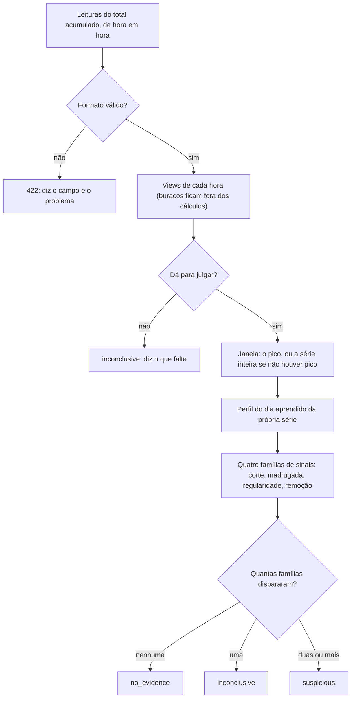

# Views que não parecem humanas

Classificador explicável para séries de views por hora. A API recebe a série de um vídeo e devolve uma de três classificações (`no_evidence`, `inconclusive` ou `suspicious`), um motivo em português que dá para ler sem conhecer o código e os sinais que usou. Não há modelo opaco nem pontuação: cada sinal tem valor, limite e uma frase, e a regra conta quantas **famílias independentes** de sinais concordam.

O classificador não diz se o criador comprou views. Diz se a série tem os padrões de entrega automatizada que ele procura, e este README mostra com número o que ele não pega.

## Sumário

- [Por onde começar](#por-onde-começar)
- [Como rodar](#como-rodar)
- [Como funciona, em uma página](#como-funciona-em-uma-página)
- [A taxa de falso positivo](#a-taxa-de-falso-positivo) (gerada pelo comando)
- [O critério (v1)](#o-critério-v1)
- [O caso em que o classificador prefere não acusar](#o-caso-em-que-o-classificador-prefere-não-acusar)
- [A API](#a-api)
- [Como ler a resposta](#como-ler-a-resposta)
- [Dataset](#dataset)
- [Avaliação](#avaliação)
- [O que o critério não detecta e onde pode errar](#o-que-o-critério-não-detecta-e-onde-pode-errar)
- [Alternativas consideradas](#alternativas-consideradas)
- [Estrutura do código](#estrutura-do-código)
- [Testes](#testes)
- [Próximos passos](#próximos-passos)
- [Uso de IA](#uso-de-ia)

## Por onde começar

- **Para avaliar:** a [taxa de falso positivo](#a-taxa-de-falso-positivo), que é um bloco escrito pelo comando e amarrado por teste, traz também o caso em que o classificador prefere não acusar, com a resposta completa da API. Depois, [o critério](#o-critério-v1) e [o que ele não detecta](#o-que-o-critério-não-detecta-e-onde-pode-errar).
- **Para ver a regra no código:** [`src/sinais.ts`](src/sinais.ts) tem os quatro sinais e as frases; [`src/classificador.ts`](src/classificador.ts) tem a regra e a montagem do motivo; [`src/criterios.ts`](src/criterios.ts) tem todos os limites num lugar só.
- **Para ver o raciocínio:** [`DECISOES.md`](DECISOES.md) separa o que foi decisão minha e o que foi trabalho da IA, com a calibração rodada a rodada, os erros encontrados e a avaliação crítica.

## Como rodar

Requer Node 22 ou mais novo.

```bash
npm ci
npm test
npm run evaluate
npm start
```

| Comando | O que faz |
|---|---|
| `npm test` | Roda todos os testes, inclusive o que compara o bloco deste README com o que a avaliação mede agora. |
| `npm run evaluate` | Gera o dataset da semente do relatório (`data/dataset.jsonl`), classifica as 1.000 séries pela mesma porta da API, mede também 10 sementes de comparação, grava `results/metrics.json` e reescreve o bloco da [taxa de falso positivo](#a-taxa-de-falso-positivo). |
| `npm run evaluate -- --dev` | Mede só a semente de desenvolvimento, a usada para calibrar, e não grava nada. |
| `npm start` | Sobe a API em `http://127.0.0.1:3009` (a variável `PORT` muda a porta). |
| `npm run typecheck` | Checa os tipos. |

Com a API no ar, uma série pronta de [`docs/exemplos/`](docs/exemplos/):

```bash
curl -s -X POST http://127.0.0.1:3009/classify -H 'content-type: application/json' --data @docs/exemplos/saida-do-algoritmo.json
```

Mais exemplos, com as respostas que o servidor devolveu, em [`docs/EXEMPLOS.md`](docs/EXEMPLOS.md).

## Como funciona, em uma página



1. **Validação.** Cada leitura tem horário com fuso, em hora cheia (tolerância de 10 minutos), e o total acumulado, um inteiro. Formato errado volta 422 dizendo o campo.
2. **Views de cada hora.** A API calcula a diferença entre leituras seguidas. Quando falta uma leitura, o volume do buraco não se perde, mas as horas dele ficam fora de todos os cálculos: preencher um buraco cria horas idênticas, que é a assinatura de robô. Uma queda do total vira hora de queda, que só conta para o sinal de remoção.
3. **Dá para julgar?** É preciso ter pelo menos 48 horas, no máximo 10% das horas sem leitura, nenhum buraco de mais de 6 horas e o total contado de forma exata, sem arredondamento. Senão, a resposta é `inconclusive` e diz o que falta.
4. **Janela.** O trecho em que o volume, em média móvel de 24 horas, passa de 3 vezes o nível habitual da série. Sem pico, a janela é a série inteira; com vários picos, cada um é julgado, e vale o que reuniu mais indícios.
5. **Perfil do dia.** Em que horas este público costuma dormir e qual é o seu horário mais forte, aprendidos da própria série, fora dos picos. O fuso informado só serve para escrever as horas no motivo.
6. **Sinais e regra.** Quatro famílias de sinais, cada uma com valor e limite. Conta-se família, não sinal: nenhuma leva a `no_evidence`, uma a `inconclusive`, duas ou mais a `suspicious`.
7. **Motivo.** Cada sinal traz a sua frase, e o motivo é montado a partir delas, com a explicação inocente de cada indício e o contexto (altura do pico, subida em degrau), que aparece mas nunca conta.

## A taxa de falso positivo

O bloco abaixo é escrito por `npm run evaluate`; ninguém digita número aqui. O teste [`test/avaliacao.test.ts`](test/avaliacao.test.ts) roda a mesma avaliação em memória e falha se o bloco divergir do que seria gerado agora, mostrando o número do README, o medido e o comando a rodar. Outro teste falha se a taxa passar da meta, para ninguém "resolver" uma piora só regenerando o README.

**O que essa taxa mede:** o classificador contra o meu próprio gerador de séries, não contra o mundo real. Ela vale enquanto as premissas do gerador (ver [Dataset](#dataset)) valerem. Os limites foram calibrados olhando só a semente de desenvolvimento (7); o número abaixo sai de outra semente (2026), e a faixa, de outras 10 sementes (101 a 110), que os limites também não viram.

Como ler o bloco:

- **Falso positivo** é legítimo classificado como `suspicious`. Inconclusivo não é falso positivo: é a cautela, e tem a sua própria linha.
- O **intervalo de 95%** é o de Clopper-Pearson, exato e bilateral: com 600 séries legítimas, mesmo zero erros não provam uma taxa abaixo de 0,5% (ver [Próximos passos](#próximos-passos)).
- **Por tipo de série** mostra onde cada classificação cai; a coluna "Esperado" é a premissa do desenho para cada tipo.
- **Regras alternativas** aplica os mesmos sinais com outra regra de acusação, para mostrar o custo de cada escolha.
- **Motivos dos exemplos** são os textos que a API devolve para as séries fixas dos testes.

<!-- evaluate:begin -->
<!-- Gerado por `npm run evaluate`. Não edite à mão: test/avaliacao.test.ts falha se este bloco divergir do medido. -->

Medido no dataset da semente **2026** (`data/dataset.jsonl`, 1.000 séries de 168 horas, sha256 `0a0433ffbd08158a…`), critério **v1**.

| | Medido | Meta |
|---|---|---|
| **Falso positivo** (legítimo classificado como suspeito) | **0,00% (0 de 600)**; intervalo de 95%: 0,00% a 0,61% | até 0,5% |
| Falso positivo nos legítimos comuns | 0 de 340 | zero |
| Falso positivo nos legítimos difíceis | 0 de 260 | entra no total acima |
| Inconclusivo nos legítimos comuns | 0,9% (3 de 340) | até 2% |
| Inconclusivo nos legítimos difíceis | 36,9% (96 de 260) | esperado: é o custo da cautela |
| Detecção nas compras típicas | 88,0% (264 de 300) | pelo menos 80% |
| Detecção nas compras disfarçadas | 0,0% (0 de 100) | nenhuma: o critério não as pega |

**Por tipo de série**

| Grupo | Tipo | Séries | Sem indícios | Inconclusivo | Suspeito | Esperado |
|---|---|---:|---:|---:|---:|---|
| Legítimo comum | Criador pequeno com ciclo diário | 100 | 100 | 0 | 0 | sem indícios |
| Legítimo comum | Crescimento lento | 60 | 60 | 0 | 0 | sem indícios |
| Legítimo comum | Pico de fim de semana | 60 | 59 | 1 | 0 | sem indícios |
| Legítimo comum | Viral orgânico | 120 | 118 | 2 | 0 | sem indícios |
| Legítimo difícil | Menção de conta grande | 80 | 80 | 0 | 0 | sem indícios |
| Legítimo difícil | Saída do algoritmo | 60 | 26 | 34 | 0 | inconclusivo |
| Legítimo difícil | Impulsionamento pago na plataforma | 60 | 11 | 49 | 0 | inconclusivo |
| Legítimo difícil | Público em vários fusos | 60 | 47 | 13 | 0 | sem indícios ou inconclusivo |
| Compra típica | Platô comprado | 80 | 0 | 2 | 78 | suspeito |
| Compra típica | Gotejamento constante | 60 | 0 | 1 | 59 | suspeito |
| Compra típica | Pico seguido de remoção | 50 | 0 | 0 | 50 | suspeito |
| Compra típica | Viral orgânico com pacote somado | 70 | 6 | 27 | 37 | suspeito |
| Compra típica | Entregas em lotes redondos | 40 | 0 | 0 | 40 | suspeito |
| Compra disfarçada | Compra que imita gente | 50 | 46 | 4 | 0 | escapa (documentado) |
| Compra disfarçada | Compra pequena (menos de 15% do volume) | 50 | 50 | 0 | 0 | escapa (documentado) |

**Regras alternativas** (os mesmos sinais; muda só quantas famílias precisam concordar para acusar)

| Regra | Falso positivo | Inconclusivo nos comuns | Detecção nas típicas | Detecção nas disfarçadas |
|---|---|---|---|---|
| Uma família basta | 16,50% (99 de 600) | 0,0% (0 de 340) | 98,0% (294 de 300) | 4,0% (4 de 100) |
| **Duas famílias (v1, a adotada)** | 0,00% (0 de 600) | 0,9% (3 de 340) | 88,0% (264 de 300) | 0,0% (0 de 100) |
| Três famílias | 0,00% (0 de 600) | 0,9% (3 de 340) | 23,0% (69 de 300) | 0,0% (0 de 100) |

**Variação entre sementes** (10 sementes, de 101 a 110, também fora da calibração)

| | Menor | Maior | Somando as sementes |
|---|---|---|---|
| Falso positivo | 0,00% | 0,17% | 0,02% (1 de 6.000) |
| Inconclusivo nos legítimos comuns | 0,0% | 1,2% | 0,7% (24 de 3.400) |
| Detecção nas compras típicas | 86,3% | 89,0% | 87,5% (2.624 de 3.000) |
| Detecção nas compras disfarçadas | 0,0% | 0,0% | 0,0% (0 de 1.000) |

**Motivos dos exemplos** (`src/exemplos.ts`, os mesmos dos testes)

- **Viral orgânico (gêmeo):** sem indícios. "Nenhum sinal de entrega automatizada. O pico não terminou de uma vez: a maior queda em duas horas, descontada a queda normal do horário, foi de 48%. Nas madrugadas, entre 3h e 8h, quando este público costuma dormir, o volume ficou em no máximo 27% do horário mais forte. As contagens variaram como variam pessoas independentes: umas 52 views para cima ou para baixo, quando o acaso sozinho daria umas 16 views. O total acumulado nunca caiu. O pico chegou a 1.000 views por hora, 53 vezes o nível habitual deste vídeo; altura de pico não é sinal, porque é o que acontece quando um vídeo estoura. A subida foi brusca, de cerca de 21 para 370 views por hora em até duas horas, às 14h do dia 10; isso também acontece quando uma conta grande menciona o criador, e subida não é sinal. Isso não certifica que as views são de pessoas, só que os padrões procurados não aparecem."
- **Platô comprado (gêmeo, mesma subida, mesma altura e mesmo total):** suspeito. "A queda das 15h do dia 11 foi abrupta: em duas horas, o volume foi de cerca de 1.000 para 28 views por hora. Descontada a queda normal desse horário (9%), são 97% a menos, e o volume não voltou no dia seguinte. O volume não diminuiu de madrugada: entre 2h e 7h do dia 11, quando este público costuma dormir, ficou em 97% do horário mais forte (fora do pico, essas horas caíam para 32%). Entre 14h do dia 10 e 16h do dia 11, o vídeo recebeu cerca de 970 views por hora, variando umas 8 views para cima ou para baixo; com esse volume, pessoas independentes fariam a contagem variar umas 31 views. Três sinais independentes concordam: o padrão é compatível com entrega automatizada, o que não identifica quem a contratou. Esse alcance precisa de revisão antes de entrar na decisão de renovação."
- **Saída do algoritmo (o caso em que o classificador prefere não acusar):** inconclusivo. "A queda das 14h do dia 12 foi abrupta: em duas horas, o volume foi de cerca de 860 para 190 views por hora. Descontada a queda normal desse horário (17%), são 74% a menos, e o volume não voltou no dia seguinte. Isso acontece quando um pacote de views acaba, mas também quando a plataforma para de recomendar o vídeo ou quando um impulsionamento pago termina. Os outros sinais são de público humano. Nas madrugadas, entre 2h e 7h, quando este público costuma dormir, o volume ficou em no máximo 25% do horário mais forte. As contagens variaram como variam pessoas independentes: umas 223 views para cima ou para baixo, quando o acaso sozinho daria umas 36 views. O total acumulado nunca caiu. Um indício isolado não basta para acusar. O pico chegou a 3.100 views por hora, 48 vezes o nível habitual deste vídeo; altura de pico não é sinal, porque é o que acontece quando um vídeo estoura. A subida foi brusca, de cerca de 86 para 1.600 views por hora em até duas horas, às 19h do dia 10; isso também acontece quando uma conta grande menciona o criador, e subida não é sinal."

<details><summary>Resposta completa da API para a saída do algoritmo</summary>

```json
{
  "classification": "inconclusive",
  "reason": "A queda das 14h do dia 12 foi abrupta: em duas horas, o volume foi de cerca de 860 para 190 views por hora. Descontada a queda normal desse horário (17%), são 74% a menos, e o volume não voltou no dia seguinte. Isso acontece quando um pacote de views acaba, mas também quando a plataforma para de recomendar o vídeo ou quando um impulsionamento pago termina. Os outros sinais são de público humano. Nas madrugadas, entre 2h e 7h, quando este público costuma dormir, o volume ficou em no máximo 25% do horário mais forte. As contagens variaram como variam pessoas independentes: umas 223 views para cima ou para baixo, quando o acaso sozinho daria umas 36 views. O total acumulado nunca caiu. Um indício isolado não basta para acusar. O pico chegou a 3.100 views por hora, 48 vezes o nível habitual deste vídeo; altura de pico não é sinal, porque é o que acontece quando um vídeo estoura. A subida foi brusca, de cerca de 86 para 1.600 views por hora em até duas horas, às 19h do dia 10; isso também acontece quando uma conta grande menciona o criador, e subida não é sinal.",
  "families_fired": [
    "abrupt_end"
  ],
  "analyzed_window": {
    "start": "2026-03-10T19:00:00-03:00",
    "end": "2026-03-12T23:00:00-03:00",
    "hours": 52,
    "kind": "peak"
  },
  "signals": [
    {
      "signal": "abrupt_end",
      "family": "abrupt_end",
      "threshold": 0.7,
      "fires_when": "above",
      "evaluable": true,
      "fired": true,
      "value": 0.74,
      "explanation": "A queda das 14h do dia 12 foi abrupta: em duas horas, o volume foi de cerca de 860 para 190 views por hora. Descontada a queda normal desse horário (17%), são 74% a menos, e o volume não voltou no dia seguinte."
    },
    {
      "signal": "awake_at_night",
      "family": "awake_at_night",
      "threshold": 0.8,
      "fires_when": "above",
      "evaluable": true,
      "fired": false,
      "value": 0.25,
      "explanation": "Nas madrugadas, entre 2h e 7h, quando este público costuma dormir, o volume ficou em no máximo 25% do horário mais forte."
    },
    {
      "signal": "low_variation",
      "family": "regularity",
      "threshold": 0.35,
      "fires_when": "below",
      "evaluable": true,
      "fired": false,
      "value": 6.14,
      "explanation": "As contagens variaram como variam pessoas independentes: umas 223 views para cima ou para baixo, quando o acaso sozinho daria umas 36 views."
    },
    {
      "signal": "round_counts",
      "family": "regularity",
      "threshold": 0.4,
      "fires_when": "above",
      "evaluable": true,
      "fired": false,
      "value": 0,
      "explanation": "As contagens não se concentram em centenas exatas."
    },
    {
      "signal": "removal",
      "family": "removal",
      "threshold": 0.01,
      "fires_when": "above",
      "minimum_views": 100,
      "evaluable": true,
      "fired": false,
      "value": 0,
      "explanation": "O total acumulado nunca caiu."
    }
  ],
  "context": {
    "habitual_views_per_hour": 65,
    "peak_views_per_hour": 3092,
    "peak_multiple": 47.9,
    "window_views": 67743,
    "step_rise": true,
    "peak_windows": 1
  },
  "insufficient_data": [],
  "rule": "suspeito exige duas famílias de sinais; com uma, inconclusivo",
  "criteria_version": "v1",
  "data_quality": {
    "hours": 168,
    "missing_readings": 0,
    "longest_gap_hours": 0,
    "drop_hours": 0,
    "nonzero_readings": 169,
    "round_readings": 2
  },
  "audience_timezone": "America/Sao_Paulo"
}
```

</details>
<!-- evaluate:end -->

## O critério (v1)

### As três saídas

| Classificação | O que quer dizer |
|---|---|
| `no_evidence` (sem indícios) | Nenhuma família de sinais disparou. Não certifica que as views são de pessoas: só diz que os padrões procurados não aparecem, e existe compra que o critério não encontra. |
| `inconclusive` | Uma família disparou (todo sinal tem uma explicação inocente) ou faltam dados para julgar. O motivo diz qual dos dois. |
| `suspicious` | Duas ou mais famílias independentes concordam. O motivo descreve o padrão ("compatível com entrega automatizada"), nunca a intenção: uma compra feita por terceiros para prejudicar o criador gera a mesma série. **Suspeito significa "esse alcance não entra na decisão de renovação sem revisão", não punição automática.** |

Não há pontuação nem "confiança". Uma nota como 0,87 sugere uma probabilidade que só poderia ser calibrada no próprio dataset sintético, o que seria circular. A força da evidência é o número de famílias que concordaram, que é a própria regra. A resposta traz `criteria_version` para uma decisão antiga poder ser refeita com os limites da época.

### As quatro famílias de sinais

O tamanho do pico nunca é sinal, porque estourar é o que um viral faz. O que separa o orgânico do comprado é o comportamento do volume, e cada família faz uma pergunta sobre ele:

| Família | Pergunta | Dispara quando | O que também produz isso sem compra |
|---|---|---|---|
| Corte (`abrupt_end`) | Como o pico termina? | O volume cai 70% ou mais em até 2 horas, descontada a queda normal daquele horário, e não volta no dia seguinte | O vídeo sai da recomendação; um impulsionamento pago acaba; o post é arquivado |
| Madrugada (`awake_at_night`) | O público dorme? | Nas horas em que este público costuma dormir, o volume fica em 80% ou mais do horário mais forte | Público espalhado por vários fusos |
| Regularidade (`regularity`) | Varia como gente? | A variação de hora em hora fica abaixo de 35% do que o acaso produz sozinho, ou 40% das horas com mais de 200 views são centenas exatas | Série preenchida por quem coletou; contagem arredondada pela fonte |
| Remoção (`removal`) | A plataforma tirou views? | O total acumulado cai mais de 1% e pelo menos 100 views | Ajuste de contagem da própria plataforma |

A regularidade é o sinal mais bem fundamentado: com 1.000 views por hora vindas de pessoas que decidem de forma independente, a contagem varia umas 30 para cima ou para baixo só por acaso, e tendências e ondas só aumentam essa variação. Um pico que varia 3 views é mais regular do que gente consegue ser.

### A regra

Nenhuma família leva a `no_evidence`; uma, a `inconclusive`; duas ou mais, a `suspicious`. **Conta-se família, não sinal**, para o mesmo fenômeno não votar duas vezes: 1.000 views exatas por hora são "regular demais" e "centena exata", mas é uma evidência só. A última coluna da tabela acima é a justificativa da regra: todo sinal tem uma explicação inocente, e o comportamento de um público real não produz dois deles ao mesmo tempo (a exceção que a avaliação crítica encontrou, duas ações da plataforma juntas, está em [onde pode errar](#o-que-o-critério-não-detecta-e-onde-pode-errar)).

**Altura do pico, volume total e subida em degrau não são sinais.** Subida brusca acontece quando uma conta grande menciona o criador. Elas aparecem no motivo como contexto e não contam.

**Só views.** Nenhum dado influencia a acusação sem estar no dataset que mede o falso positivo. O tamanho habitual do criador fica de fora por princípio: estourar muito acima do habitual é o que um viral faz, e usar isso puniria o criador pequeno que viralizou.

### A janela em análise

É o trecho em que o volume, em média móvel de 24 horas, passa de 3 vezes o nível habitual da própria série. Quando não há pico, a janela é a série inteira, e é assim que o gotejamento constante aparece. Com mais de um pico, cada janela é julgada separadamente, e a que reuniu mais indícios define a classificação.

### Como cada sinal é medido

As decisões acima são do desenho; os detalhes abaixo são a implementação, em [`src/sinais.ts`](src/sinais.ts) e [`src/janela.ts`](src/janela.ts). Todos os limites estão em [`src/criterios.ts`](src/criterios.ts) e são publicados em `GET /criteria`.

- **Nível habitual:** o primeiro quartil da média de 24 horas (no mínimo 1 view por hora). Quartil, e não mediana, porque uma compra que ocupa mais da metade da série puxaria a mediana para cima e esconderia o próprio pico. A janela vai da primeira à última hora que, sozinha, passa de 3 vezes esse nível, dentro do trecho em que a média de 24 horas passa (a média espalha o pico para as horas vizinhas).
- **Perfil do dia:** para cada hora do dia, o volume relativo à média de 24 horas ao redor, aprendido fora dos picos (ou na série inteira, se fora deles houver menos de dois dias). As horas de sono são as 5 seguidas mais fracas. Com menos de 2 views por hora em média, o perfil não é aprendido, e a madrugada fica não avaliável.
- **Corte:** para cada hora da janela, compara o nível das 3 horas antes da virada com o das 2 horas logo depois (a queda completa em até 2 horas). Só a queda normal do horário é descontada; num horário em que o volume costuma subir, não subir não vira queda. "Não volta no dia seguinte" compara o dia seguinte (18 horas ao redor de 27 horas depois) com o nível de antes, descontado o ciclo; se voltou a metade ou mais, a queda não conta. Uma queda que não dá para conferir no dia seguinte fica não avaliável. A queda só conta a partir de 20 views por hora e do nível de pico.
- **Madrugada:** cada madrugada da janela é comparada com as 3 horas seguidas mais fortes nas 12 horas antes e nas 12 depois (os dois lados precisam existir), e vale a madrugada mais acordada. Se há pico e, fora dele, as horas de sono já têm mais da metade do volume das mais fortes, o público não tem madrugada marcada (como acontece com público em vários fusos), e o sinal fica não avaliável. Sem pico, a madrugada é comparada direto, e é assim que o gotejamento aparece. Precisa de 20 views por hora no horário de referência.
- **Regularidade:** para horas seguidas, z = (b − a) / √(a + b). O desvio típico robusto, a mediana de |z| ÷ 0,6745, fica perto de 1 para pessoas independentes, acima disso com ondas e ciclo do dia, e perto de 0 para entrega mecânica. Precisa de 12 pares de horas medidas. As centenas exatas precisam de 10 horas com mais de 200 views; com contagem exata, só 1% delas cairia numa centena.
- **Remoção:** olha a série inteira, e não só a janela, porque a plataforma costuma tirar as views dias depois do pico. Mede a maior queda do total em relação ao maior total já lido antes dela. Quedas de até 1% ou de menos de 100 views são recontagem e não contam.
- **Sinal não avaliável não conta**, e o motivo diz por quê.

### Quando a série não dá para julgar

A resposta é `inconclusive`, sem sinais, com a lista do que falta em `insufficient_data`, em quatro situações:

| Situação | Por quê |
|---|---|
| Menos de 48 horas entre a primeira e a última leitura | Sem dois dias, não dá para comparar um dia com o outro nem aprender a madrugada. |
| Mais de 10% das horas sem leitura | O volume dos buracos não se perde, mas as horas deles ficam fora dos cálculos. |
| Um buraco de mais de 6 horas seguidas | Um buraco desses pode esconder uma madrugada ou um corte inteiro. |
| **Total arredondado pela fonte:** 95% ou mais das leituras acima de zero são centenas exatas | Com contagem exata, só 1% das leituras cai numa centena. Com o total arredondado ("1,2 mil"), toda hora vira centena exata e as horas fracas andam de 100 em 100, o que simula regularidade e corte. Sem esta regra, um viral orgânico com o total arredondado saía **suspeito** (`test/limites.test.ts`). |

O motivo termina pedindo leituras exatas, medidas de hora em hora, sem arredondamento nem preenchimento.

## O caso em que o classificador prefere não acusar

**A saída do algoritmo.** Um viral despenca quando a plataforma para de recomendar o vídeo: o volume cai 70% ou mais em uma ou duas horas e não volta. É o mesmo corte de um pacote de views que acaba. Mas nesse vídeo a madrugada caiu como cai a de gente e as contagens variaram como variam pessoas, então só uma família disparou. O resultado é `inconclusive`, e o motivo diz o que disparou, o que mais produz o mesmo efeito e que um indício isolado não basta para acusar.

O motivo e a resposta completa da API estão no fim do bloco da [taxa de falso positivo](#a-taxa-de-falso-positivo), gerados pelo comando. O teste está em [`test/classificador.test.ts`](test/classificador.test.ts) ("saída do algoritmo: inconclusivo, com só o corte disparado"). A linha "Saída do algoritmo" da tabela por tipo mostra onde caem as 60 séries desse tipo no dataset do relatório; nas 10 sementes da faixa, uma delas saiu suspeita, e o porquê está em [onde pode errar](#o-que-o-critério-não-detecta-e-onde-pode-errar).

**E o pico orgânico que não pode cair no balde do comprado.** O teste dos gêmeos compara um viral orgânico com um platô comprado do mesmo criador, com a mesma subida, a mesma altura e o mesmo total de views na semana. O orgânico sai `no_evidence`, o comprado sai `suspicious`, e o teste confere que as famílias que diferem são exatamente o corte, a madrugada e a regularidade, nunca o tamanho.

## A API

### `POST /classify`

Sem estado: recebe a série e devolve a classificação, sem guardar nada.

```json
{
  "series": [
    { "at": "2026-03-08T00:00:00-03:00", "cumulative_views": 5000 },
    { "at": "2026-03-08T01:00:00-03:00", "cumulative_views": 5021 }
  ],
  "audience_timezone": "America/Sao_Paulo"
}
```

| Campo | Tipo | Obrigatório | Descrição |
|---|---|---|---|
| `series` | lista | sim | Leituras do total acumulado de views, de hora em hora, em ordem crescente; até 30 dias (721 leituras). A entrada é o total, que é o que a plataforma mostra: a API calcula as views de cada hora, e uma queda do total vira o sinal de remoção, e não um número negativo estranho. |
| `series[].at` | texto | sim | Horário ISO 8601 **com fuso** (`Z` ou `±HH:MM`), em hora cheia, com tolerância de 10 minutos. As contas são feitas em UTC. |
| `series[].cumulative_views` | inteiro | sim | Total acumulado lido naquele horário, maior ou igual a zero, contado de forma exata. |
| `audience_timezone` | texto | não | Fuso IANA do público, só para escrever as horas no motivo; padrão `America/Sao_Paulo`. A madrugada é aprendida da própria série, então um fuso errado muda o texto, nunca a classificação. |

`?hourly=true` acrescenta `hourly`: as views de cada hora, para exibição, com as horas de buraco marcadas como `estimated` (o volume do buraco dividido igualmente) e as de queda como `drop`.

**Envie pontos medidos, sem preenchimento nem arredondamento.** Preencher um buraco em linha reta cria horas idênticas, e arredondar o total cria centenas exatas: as duas coisas imitam robô.

### Erros

Formato errado volta com `{ "error", "field", "message" }`, e a mensagem diz o que corrigir.

| Situação | Status | `field` |
|---|---|---|
| Corpo que não é JSON | 400 | |
| Corpo acima de 1 MB | 413 | |
| Sem `series`, ou lista vazia | 422 | `series` |
| Mais de 721 leituras, ou mais de 30 dias entre a primeira e a última | 422 | `series` |
| Leitura que não é objeto | 422 | `series[i]` |
| Horário sem fuso | 422 | `series[i].at` |
| Data ou fuso que não existem | 422 | `series[i].at` |
| Horário a mais de 10 minutos de uma hora cheia | 422 | `series[i].at` |
| Duas leituras na mesma hora cheia | 422 | `series[i].at` |
| Leituras fora de ordem | 422 | `series[i].at` |
| Leitura fora da grade de hora em hora das outras (fusos de meia hora misturados) | 422 | `series[i].at` |
| Total negativo ou não inteiro | 422 | `series[i].cumulative_views` |
| Fuso do público que não existe | 422 | `audience_timezone` |

Série curta, com buracos demais ou com o total arredondado não é erro de formato: volta 200, com `inconclusive` e o que falta (ver [Quando a série não dá para julgar](#quando-a-série-não-dá-para-julgar)).

### Outros endpoints

| Endpoint | O que devolve |
|---|---|
| `GET /criteria` | A versão do critério, a regra, as famílias e todos os limites em vigor. |
| `GET /health` | `{ "ok": true }` |

## Como ler a resposta

| Campo | O que traz |
|---|---|
| `classification` | `no_evidence`, `inconclusive` ou `suspicious`. |
| `reason` | O motivo em português, montado a partir das frases dos sinais. |
| `rule` | A regra em vigor: "suspeito exige duas famílias de sinais; com uma, inconclusivo". |
| `criteria_version` | A versão do critério (`v1`), para refazer uma decisão antiga com os limites da época. |
| `families_fired` | As famílias que dispararam na janela julgada. |
| `analyzed_window` | Início e fim da janela no fuso do público, quantas horas ela tem e se é um pico (`peak`) ou a série inteira (`whole_series`). |
| `signals` | Os cinco sinais da janela julgada (tabela abaixo). |
| `context` | Nível habitual e pico em views por hora, quantas vezes o pico passou do habitual, views na janela, se houve subida em degrau e quantos picos a série teve. É contexto: nada aqui entra na regra. |
| `data_quality` | Horas da série, leituras faltando, maior buraco, horas de queda do total, leituras acima de zero e quantas delas são centenas exatas. |
| `insufficient_data` | O que falta, quando a série não dá para julgar; lista vazia quando dá. |
| `audience_timezone` | O fuso usado para escrever as horas. |

Cada item de `signals` tem `signal`, `family`, `evaluable`, `fired`, `value`, `threshold`, `fires_when` e `explanation` (a frase). Quando `evaluable` é `false`, `value` é `null`, o sinal não conta e a frase diz por quê.

| Sinal | Família | O que é o valor | Dispara quando |
|---|---|---|---|
| `abrupt_end` | corte | A maior queda em 2 horas, descontada a queda normal do horário, entre as que não voltaram no dia seguinte (de 0 a 1) | 0,70 ou mais |
| `awake_at_night` | madrugada | Volume da madrugada mais acordada da janela dividido pelo horário mais forte ao redor dela | 0,80 ou mais |
| `low_variation` | regularidade | Variação das contagens de hora em hora dividida pela variação que o acaso produz | abaixo de 0,35 |
| `round_counts` | regularidade | Fração das horas com mais de 200 views que são centenas exatas | 0,40 ou mais |
| `removal` | remoção | Maior queda do total dividida pelo maior total lido antes dela; `minimum_views` traz o mínimo de 100 views | acima de 0,01 e com pelo menos 100 views |

## Dataset

`npm run evaluate` gera 1.000 séries de 7 dias (168 horas) com um gerador pseudoaleatório próprio (mulberry32), e não com o `Math.random`, para não depender da versão do Node. Cada série tem a própria semente, derivada da semente do dataset, do tipo e do índice: mudar um tipo não altera as séries dos outros. Nada vem de rede social real.

**Arquivo.** [`data/dataset.jsonl`](data/dataset.jsonl) está no repositório, uma série por linha, com `id`, `type`, `group`, `truth` (orgânica ou comprada), `expected` (o resultado que o desenho espera para o tipo), `params` (os parâmetros sorteados que geraram a série), `start` (o horário da primeira leitura) e `readings` (as leituras do total acumulado, com `null` onde a leitura falta). Um teste confere que regenerá-lo dá o mesmo arquivo, com o mesmo hash.

**Sementes.**

| Semente | Para quê |
|---|---|
| 7 | Desenvolvimento: os limites e a implementação foram calibrados olhando só para ela. |
| 2026 | Relatório: o dataset do repositório e o número do README. Só foi aberta depois de o classificador ser congelado. |
| 101 a 110 | Faixa: mostra quanto o número varia de uma semente para outra. |

**Composição.** 600 séries legítimas e 400 compradas, em quatro grupos (as quantidades de cada tipo estão na tabela do bloco):

- **Legítimos comuns:** os casos do dia a dia, que nunca podem ser acusados.
- **Legítimos difíceis:** desenhados para tropeçar em exatamente um sinal cada.
- **Compras típicas:** o que o critério foi feito para pegar.
- **Compras disfarçadas:** desenhadas para escapar, para mostrar com número o que o critério não detecta.

**Premissas.** Os parâmetros de cada tipo são as premissas do teste: a taxa vale enquanto elas valerem.

| Tipo | Premissa |
|---|---|
| Público orgânico (base de todos) | Nível de 3 a 150 views por hora (escala logarítmica). Ciclo do dia com madrugada fraca e pico à noite, em que as horas de sono têm de 16% a 33% do horário mais forte. Cada hora é sorteada por Poisson sobre a intensidade multiplicada por uma gama de média 1 (pessoas chegam em ondas), mais ondas lentas que voltam à média. |
| Criador pequeno com ciclo diário | Só o público orgânico. |
| Crescimento lento | O nível multiplica de 1,5 a 4 vezes ao longo da semana. |
| Pico de fim de semana | Sábado e domingo com 1,5 a 2,5 vezes o volume, com rampas de 6 horas. |
| Viral orgânico | Nível de 5 a 300; o viral chega de 8 a 60 vezes o nível, sobe em 2 a 8 horas e cai pela metade a cada 12 a 60 horas, seguindo o ciclo do dia. |
| Menção de conta grande | Degrau de 4 a 40 vezes em uma hora, caindo pela metade a cada 24 a 96 horas. |
| Saída do algoritmo | Viral; de 4 a 30 horas depois do pico, o volume do viral cai para 5% a 25% em 1 a 2 horas e não volta. |
| Impulsionamento pago na plataforma | De 3 a 12 vezes o volume por 24 a 72 horas, começando e terminando em degrau de uma hora; é gente real, então segue o ciclo do dia. |
| Público em vários fusos | 2 ou 3 públicos em fusos a pelo menos 6 horas de distância; viral; um terço com corte da plataforma. |
| Platô comprado | Entrega de 8 a 60 vezes o público por 18 a 48 horas, variando de 0,1% a 0,4%, subindo em até uma hora e parando de uma vez; termina ao menos 28 horas antes do fim da série. |
| Gotejamento constante | Criador pequeno (2 a 15 views por hora) com 100 a 600 views por hora entregues durante toda a série, variando de 0,2% a 1%. |
| Pico seguido de remoção | Platô de 6 a 24 horas; de 12 a 48 horas depois, a plataforma tira de 30% a 90% das views entregues, em 1 a 6 horas. |
| Viral orgânico com pacote somado | Viral, mais um pacote de 3 a 10 vezes o volume orgânico do momento, por 12 a 36 horas, começando até 24 horas depois do viral. |
| Entregas em lotes redondos | Vídeo quase sem público (0,1 a 0,6 views por hora) com lotes de 200 a 2.000 views, em centenas exatas, em 35% a 80% das horas, por 48 a 80 horas. |
| Compra que imita gente | Entrega com ciclo do dia e irregularidade humana, de 4 a 30 vezes o público, por 36 a 72 horas; sobe em 4 a 10 horas e desliga aos poucos (cai pela metade a cada 4 a 10 horas). |
| Compra pequena | De 3% a 15% do volume orgânico da semana, como platô de 12 a 48 horas ou gotejamento na série inteira. |
| Artefatos de coleta (em todos) | Cerca de 10% das séries perdem de 1 a 4 leituras; 5% das legítimas têm de 1 a 3 recontagens para baixo, de até 30 views e até 0,3% do total. |

## Avaliação

O que `npm run evaluate` faz, em ordem:

1. Gera as 1.000 séries da semente 2026 e grava `data/dataset.jsonl`.
2. Para cada série, monta o corpo do `POST /classify`, valida pela mesma porta da API e chama a mesma função pura (`classify`). A taxa medida é a da API, não a de uma cópia.
3. Conta, por grupo e por tipo, quantas séries caíram em cada classificação; calcula o intervalo de 95% do falso positivo; reaplica os mesmos sinais com as regras alternativas (uma, duas ou três famílias); e mede as 10 sementes da faixa.
4. Classifica as séries fixas de [`src/exemplos.ts`](src/exemplos.ts) para os motivos de exemplo.
5. Grava tudo em [`results/metrics.json`](results/metrics.json), inclusive a classificação e as famílias de cada série, e reescreve o bloco deste README entre os marcadores.

**Metas do desenho**, conferidas por teste a cada `npm test`:

| Meta | Limite |
|---|---|
| Falso positivo nos legítimos, com os difíceis incluídos | no máximo 0,5% |
| Falso positivo nos legítimos comuns | zero |
| Inconclusivo nos legítimos comuns | no máximo 2% |
| Detecção nas compras típicas | pelo menos 80% |

A meta de falso positivo é baixa por causa da proporção real de compradores. No dataset, 40% das séries são compradas; no mundo real, a proporção deve ser bem menor. Se 2% dos criadores compram e o classificador pega 85% deles, 1% de falso positivo faz mais de uma em cada três acusações ser injusta; com 0,5%, pouco mais de uma em cada cinco. É por isso que `suspicious` leva a revisão, nunca a punição automática.

**Para mudar o critério:** mude o limite em [`src/criterios.ts`](src/criterios.ts), suba `CRITERIA_VERSION`, rode `npm run evaluate` e `npm test` (o teste de metas impede que uma piora passe só porque o README foi regenerado) e registre o motivo em [`DECISOES.md`](DECISOES.md).

## O que o critério não detecta e onde pode errar

**Não pega**, e o dataset mostra isso com número (as compras disfarçadas no bloco):

- compra que imita gente: ruído humano, pausa de madrugada e desligamento aos poucos;
- compra pequena perto do volume orgânico, que também infla pouco;
- fazenda de celulares operados por pessoas, com ritmo e variação humanos;
- compra feita antes do início da série;
- e não diz quem contratou a entrega.

**Deixa passar parte das compras típicas** (medido em [`test/limites.test.ts`](test/limites.test.ts)):

- um **gotejamento** só é acusado quando é quase todo o volume. No cenário testado, com 70% das views ele passa sem indícios; com 90%, fica inconclusivo só pela madrugada; com 98%, é acusado. É o preço do limite de 35% na regularidade: a variação do público real que continua chegando esconde a entrega;
- um **pacote que não atravessa uma madrugada inteira** só mostra o corte e fica inconclusivo; é o que acontece com parte do "viral orgânico com pacote somado" na tabela por tipo;
- um **gotejamento exato que parte de um total redondo** cai na regra do total arredondado e não é julgado (dados insuficientes). É o custo dessa regra; em troca, um criador cuja fonte arredonda o total não é mais acusado.

**Pode errar contra o criador** (medido em [`test/limites.test.ts`](test/limites.test.ts)):

- **duas ações da plataforma juntas.** Se a plataforma para de recomendar um viral (corte) e, na mesma semana, tira 2% das views como inválidas (remoção), são duas famílias, e o resultado é `suspicious`. A premissa de que nenhum comportamento humano produz dois sinais ao mesmo tempo vale para o público, mas não para duas ações da plataforma. Uma correção parcial foi medida e não adotada (ver [Alternativas consideradas](#alternativas-consideradas));
- **viral que sobe de madrugada e é cortado de manhã.** Nas 10 sementes da faixa, o único falso positivo foi uma saída do algoritmo em que o viral subiu durante a madrugada e a plataforma cortou às 9h. A madrugada ficou mais forte que as horas antes (antes do viral) e depois (depois do corte). É uma ambiguidade real: é o mesmo desenho de um robô que só rodou naquela noite;
- **série preenchida por quem coletou.** Preencher a madrugada em linha reta parece regular demais e, em tese, pode disparar dois sinais. No cenário testado, com a madrugada preenchida toda noite, o criador comum continuou sem indícios, mas a API pede pontos medidos por causa disso.

O **total arredondado pela fonte** ("1,2 mil") fazia um viral orgânico sair `suspicious`. Desde a regra do total arredondado, ele sai como dados insuficientes ([Quando a série não dá para julgar](#quando-a-série-não-dá-para-julgar)).

No sentido oposto, o **impulsionamento pago na própria plataforma** é alcance comprado com gente real: segue o ciclo do dia, varia como pessoas e termina em degrau. Ele cai em `inconclusive` (só o corte), e não em `suspicious`, de propósito: não é fraude, mas o motivo lembra que um impulsionamento pago que termina produz o mesmo corte.

## Alternativas consideradas

| Alternativa | Decisão | Por quê |
|---|---|---|
| Pontuação ou "confiança" | Não adotada | Uma nota como 0,87 sugere probabilidade, e só poderia ser calibrada no próprio dataset sintético, o que seria circular. A força da evidência já é o número de famílias. |
| Saída "legítimo" | Não adotada | O classificador não certifica nada; `no_evidence` diz só que os padrões procurados não aparecem. |
| Uma família basta para acusar | Não adotada | Todo sinal tem explicação inocente. O bloco mostra o custo com os mesmos sinais: o falso positivo dispara. |
| Três famílias para acusar | Não adotada | O bloco mostra que a detecção cai muito. |
| Tamanho habitual do criador como sinal | Não adotado | Estourar muito acima do habitual é o que um viral faz; puniria o criador pequeno que viralizou. |
| Engajamento por hora | Primeira extensão | Provavelmente é o sinal mais forte, porque view comprada quase nunca vem com curtida. Mas curtida também se compra, e o sinal exige gerar engajamento no dataset e medir tudo de novo. |
| **A.** Total arredondado vira dados insuficientes | **Adotada** | Tirou o falso positivo da contagem arredondada sem mudar nenhum número do dataset. Custo: o gotejamento exato que parte de um total redondo também não é julgado. |
| **B.** Remoção só acima de 5% | **Medida e documentada, não adotada** | Medida numa cópia, sem mudar o repositório: a limpeza de 2% junto com a saída do algoritmo deixaria de acusar, mas uma de 8% continuaria acusando, e a detecção perderia 2 compras em 3.000 nas 10 sementes. É uma correção parcial: o problema de fundo, duas ações da plataforma juntas, fica documentado. |
| **C.** Mais séries legítimas | **Documentada** | Com 600 legítimas, mesmo zero falsos positivos deixam o limite superior do intervalo de 95% em 0,61%, acima da meta de 0,5%. Para esse limite ficar abaixo de 0,5% com zero erros, são necessárias 736 séries legítimas. |

## Estrutura do código

| Arquivo | Papel |
|---|---|
| [`src/criterios.ts`](src/criterios.ts) | Versão, regra e todos os limites do critério. |
| [`src/serie.ts`](src/serie.ts) | Validação da entrada (422), views de cada hora e qualidade dos dados. |
| [`src/janela.ts`](src/janela.ts) | Média de 24 horas, nível habitual, janelas de pico e perfil do dia. |
| [`src/sinais.ts`](src/sinais.ts) | Os quatro sinais, cada um com valor, limite e frase. |
| [`src/classificador.ts`](src/classificador.ts) | A função pura: dados insuficientes, janelas, regra, contexto e motivo. |
| [`src/texto.ts`](src/texto.ts) | Números em português e horas no fuso do público. |
| [`src/app.ts`](src/app.ts), [`src/index.ts`](src/index.ts) | A API (Hono) e o servidor. |
| [`src/prng.ts`](src/prng.ts) | O gerador pseudoaleatório (mulberry32) e as distribuições. |
| [`src/gerador.ts`](src/gerador.ts) | Os 15 tipos de série, com as premissas, e os artefatos de coleta. |
| [`src/dataset.ts`](src/dataset.ts) | Sementes, formato do arquivo, hash e o corpo da API para cada série. |
| [`src/avaliacao.ts`](src/avaliacao.ts) | Métricas, intervalo de confiança e o bloco do README. |
| [`src/exemplos.ts`](src/exemplos.ts) | As séries fixas dos testes e dos exemplos. |
| [`scripts/evaluate.ts`](scripts/evaluate.ts) | O comando `npm run evaluate`. |
| [`data/dataset.jsonl`](data/dataset.jsonl), [`results/metrics.json`](results/metrics.json) | O dataset e as métricas gerados. |
| [`docs/EXEMPLOS.md`](docs/EXEMPLOS.md), [`docs/exemplos/`](docs/exemplos/) | Exemplos executados contra o servidor e os corpos usados. |

## Testes

```bash
npm test
```

| Arquivo | O que prova |
|---|---|
| [`test/classificador.test.ts`](test/classificador.test.ts) | Os casos óbvios (criador pequeno, gotejamento exato); os gêmeos, em que a diferença está no fim, na madrugada e na variação, nunca no tamanho; o viral com 100 vezes mais público e a menção de conta grande, que continuam sem indícios; a saída do algoritmo, inconclusiva só com o corte; o público em vários fusos com corte, que não vira suspeito; o público em Lisboa sem fuso informado; a pane que passa no mesmo dia, que não é corte; horas faltando, recontagem de −3 views, queda de 5%; e os casos de dados insuficientes, inclusive o total arredondado. |
| [`test/api.test.ts`](test/api.test.ts) | O contrato do `POST /classify`, os 422 com campo e motivo, o fuso que só muda o texto e a prova de que a API e a avaliação chamam a mesma função. |
| [`test/motivos.test.ts`](test/motivos.test.ts) | Os motivos dos exemplos e das 1.000 séries da semente de desenvolvimento não têm nomes do código nem número sem unidade. |
| [`test/avaliacao.test.ts`](test/avaliacao.test.ts) | O dataset regenerado tem o mesmo hash; o bloco do README e o `results/metrics.json` são idênticos ao medido; as metas valem; o intervalo de confiança bate com uma referência calculada à parte. |
| [`test/gerador.test.ts`](test/gerador.test.ts) | O gerador é determinístico, um tipo não depende dos outros e os artefatos de coleta respeitam os limites. |
| [`test/limites.test.ts`](test/limites.test.ts) | Os limites da seção [O que o critério não detecta e onde pode errar](#o-que-o-critério-não-detecta-e-onde-pode-errar), para o README não afirmar o que o código não faz. |

## Próximos passos

- **Duas ações da plataforma juntas.** Corte e remoção podem vir da mesma limpeza da plataforma. A alternativa B só resolve as limpezas pequenas; uma solução de verdade precisa de outro dado (por exemplo, saber se a plataforma anunciou a limpeza) ou de rever se a remoção deve ser uma família independente.
- **Mais séries legítimas (alternativa C).** 736 legítimas, para o limite superior do intervalo de 95% poder ficar abaixo da meta.
- **Engajamento por hora**, como primeira extensão, gerado no dataset e medido junto.
- **Validar as premissas com séries reais rotuladas**, se a Conty tiver. A taxa deste README mede o critério contra o gerador, não contra o mundo.

## Uso de IA

Ferramenta: Claude Code (Claude Opus 5.5).

- **Decisões minhas:** montei o desenho reunindo ideias de IA (outra ferramenta, fora deste repositório) e o trouxe pronto. Ele inclui:
  - as três saídas sem pontuação, com o motivo que descreve o padrão e não a intenção, e suspeito como revisão, não punição;
  - as quatro famílias com limites e explicações inocentes, a regra de contar famílias e não sinais, e altura, volume e subida em degrau como contexto;
  - a janela pela média de 24 horas e a madrugada aprendida da série, que fica não avaliável quando não há como saber;
  - a entrada pelo total acumulado, com fuso obrigatório, 422, mínimo de 48 horas e buracos sem preenchimento; só views;
  - a composição do dataset, com legítimos difíceis e compras disfarçadas;
  - o comando que reescreve o README, a semente de desenvolvimento separada da do relatório e os testes que amarram o número;
  - as metas de custo e a justificativa pela proporção real de compradores;
  - o caso em que o classificador prefere não acusar, o que o critério não detecta e a lista de testes.

  Depois da avaliação crítica da IA, decidi:
  - confirmar os padrões que ela adotou nos pontos que o desenho não fechava;
  - adotar a regra do total arredondado (A);
  - documentar, sem adotar, a remoção acima de 5% (B) e o tamanho do dataset (C).
- **Feito pela IA:**
  - a verificação de prompt injection na página;
  - as interpretações dos pontos que o desenho não fechava (seção 2 do `DECISOES.md`), entre elas o nível habitual pelo primeiro quartil, o horário mais forte ao redor de cada madrugada, a madrugada marcada até metade do volume, o desconto só de quedas normais e a remoção olhando a série inteira;
  - toda a implementação, o gerador e os parâmetros de cada tipo;
  - a calibração na semente de desenvolvimento, com os erros que ela revelou e as correções (seção 3 do `DECISOES.md`);
  - os testes, os testes de mutação e a avaliação crítica com cenários executados, inclusive a medição das alternativas A e B;
  - os exemplos, gerados executando a API;
  - o rascunho deste README.
- **O que revisei:** a revisão foi feita ao longo do processo, junto com a ferramenta. Cada decisão foi discutida comigo antes de virar código, e acompanhei os testes, os cenários, os erros introduzidos de propósito e as validações.

O raciocínio passo a passo, separando o que foi meu e o que foi da IA, está em [`DECISOES.md`](DECISOES.md).
